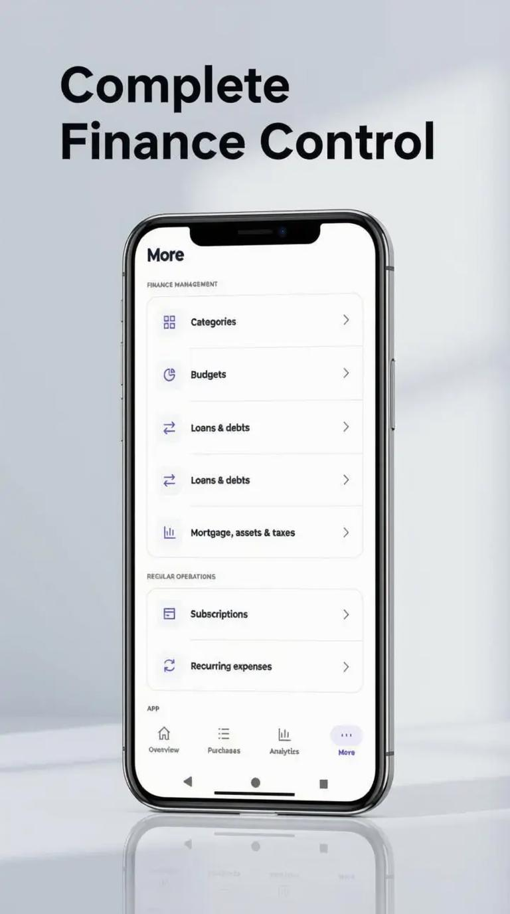
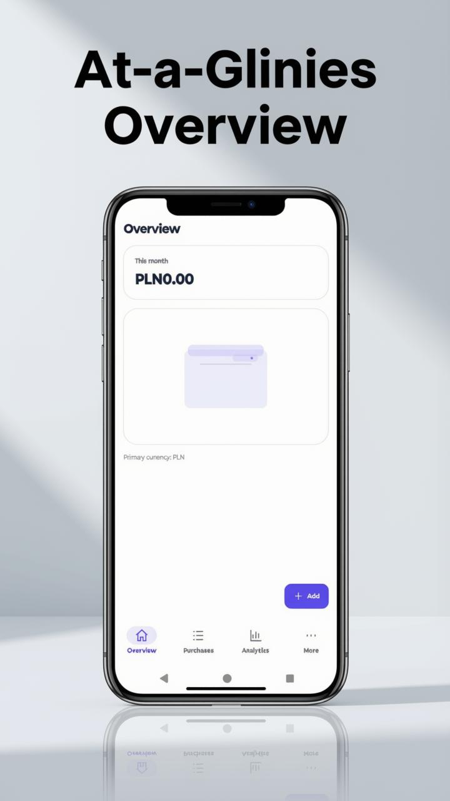
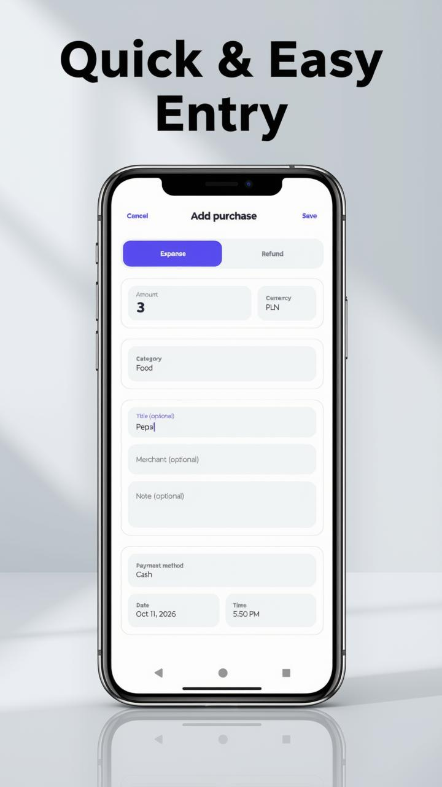
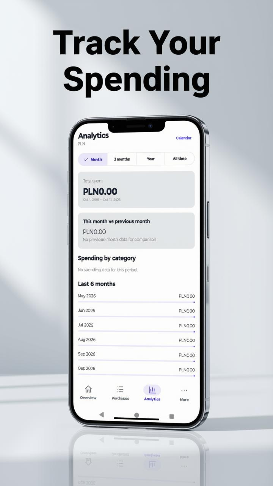
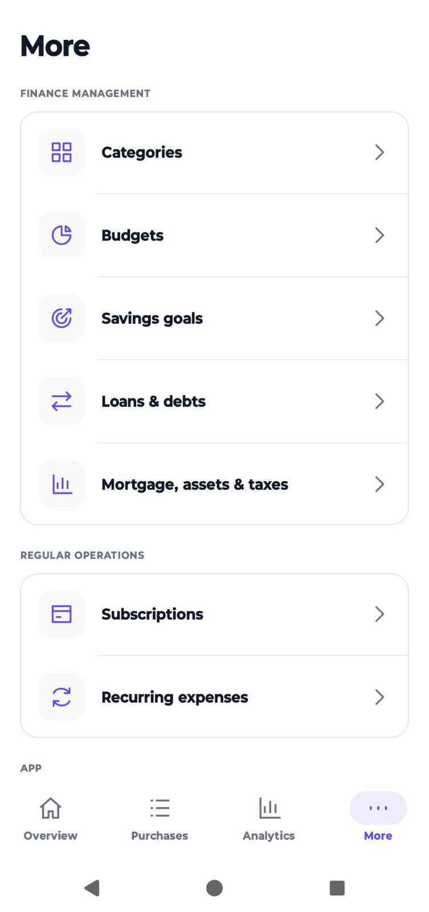
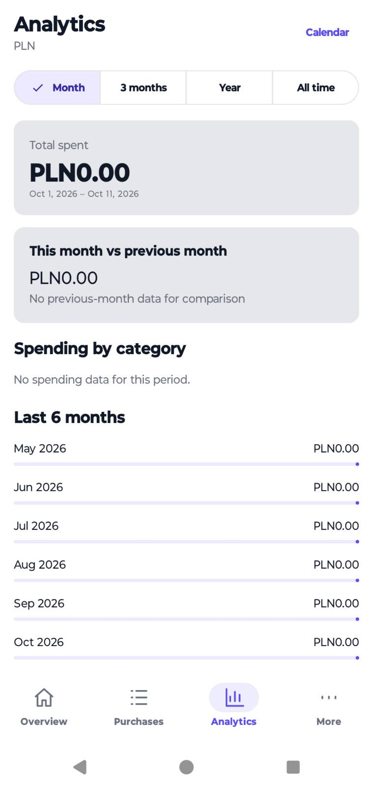
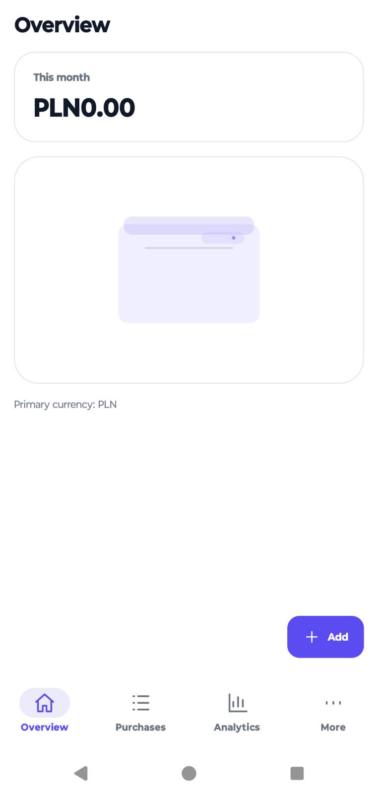
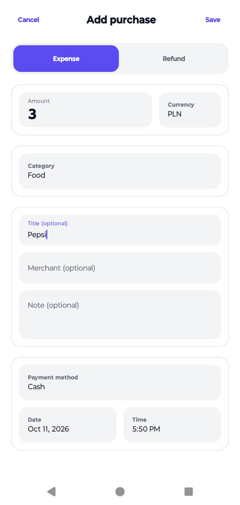
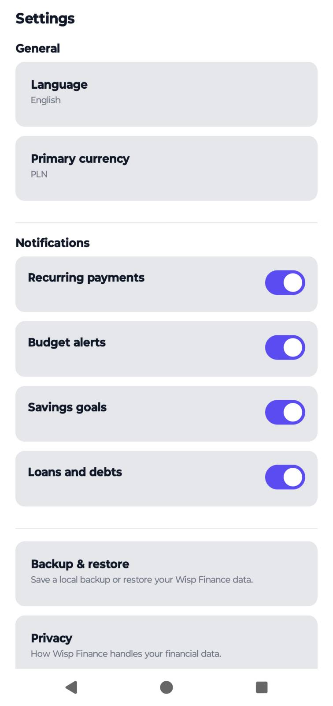
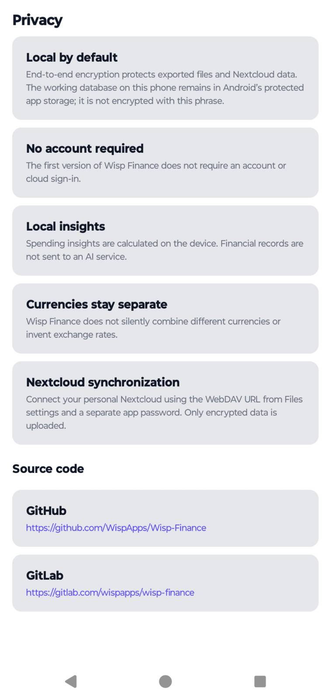

<p align="center">
  
</p>

<h1 align="center">Wisp Finance</h1>

<p align="center">
  Your finances, at your own pace.
  <br>
  An open-source Android personal finance app with budgets, savings goals, encrypted backups and optional Nextcloud sync.
</p>

<p align="center">
  <a href="https://gitlab.com/wispapps/wisp-finance">GitLab source</a> ·
  <a href="https://gitlab.com/wispapps/wisp-finance/-/issues">Report an issue</a> ·
  <a href="LICENSE">GPL-3.0-or-later</a>
</p>

<p align="center">
  
  
  
</p>

## Promotional previews

These images are promotional mockups and may differ from the current Android build. Actual app screenshots are shown below.

<p align="center">
  
  
  
</p>

## Screenshots

<table>
  <tr>
    <td></td>
    <td></td>
    <td></td>
  </tr>
  <tr>
    <td></td>
    <td></td>
    <td></td>
  </tr>
</table>

## Features

- Track expenses and organize purchases into categories.
- Plan budgets and explore spending insights and analytics.
- Manage recurring payments and subscriptions.
- Track savings goals, loans and personal debts.
- Keep investment, crypto asset and tax records, and use finance calculators.
- Choose your interface language and currency independently.
- Use light and dark themes and configure reminders.
- Export and restore encrypted backups.
- Sync through your own Nextcloud server using HTTPS WebDAV.

## Languages and setup

The interface supports English, German, Spanish, French, Italian, Dutch, Polish, Portuguese, Russian and Ukrainian.

You explicitly choose your language and primary currency during setup. Currency is not inferred from your language or region. Initial setup also covers the recovery phrase and notifications. Recovery phrases are always in English.

## Privacy, backups and recovery

Portable backups and Nextcloud sync payloads are encrypted using your recovery key. Nextcloud is optional and uses a server and credentials supplied by you.

To restore an encrypted backup, you need **both the backup file and its matching recovery phrase**. The phrase alone does not contain your financial records.

The recovery phrase uses Wisp Finance's own format: 24 hyphenated English word pairs. It is **not a BIP39 wallet seed**. Keep it private and separate from your backup files. If you copy it, clear it from clipboard and keyboard history after saving it securely. Never include recovery phrases, passwords or personal financial records in issue reports.

The working database on your phone is stored in Android's private app storage; **it is not encrypted with the recovery phrase**. The device copy of the recovery key is wrapped using Android Keystore. Clearing app data or uninstalling removes the local database and device-held key. Save an encrypted backup and its matching phrase before doing either.

## Build from source

Wisp Finance is built with Kotlin and Jetpack Compose.

### Requirements

- Android Studio and the Android SDK.
- Android SDK Platform 37; minimum supported device version is Android 8.0 (API 26).
- Java 25 Gradle toolchain, as configured in `gradle/gradle-daemon-jvm.properties`.
- Network access to download Gradle and dependencies.

Build configuration is declared in `app/build.gradle.kts`, `gradle/libs.versions.toml` and `gradle/gradle-daemon-jvm.properties`. Use the included Gradle Wrapper.

### Build a debug APK

Windows PowerShell:

```powershell
.\gradlew.bat :app:assembleDebug
```

Linux or macOS:

```sh
./gradlew :app:assembleDebug
```

The APK is created at `app/build/outputs/apk/debug/app-debug.apk`.

### Tests and release builds

Run unit tests and release Lint on Windows:

```powershell
.\gradlew.bat :app:testDebugUnitTest :app:lintRelease
```

On Linux or macOS:

```sh
./gradlew :app:testDebugUnitTest :app:lintRelease
```

Instrumented tests are under `app/src/androidTest`. Run `:app:connectedDebugAndroidTest` on a disposable emulator without personal data. Debug and release signatures differ; do not uninstall a release installation containing your data just to run tests.

Build an unsigned release with `:app:assembleRelease`. Release builds use R8 and resource shrinking. The Windows signing helper is `tools/build-and-sign-wisp-finance-release.ps1`; it requires your own release keystore and Android SDK Build Tools 34.0.0. Keep signing keys and passwords outside Git.

## F-Droid

F-Droid metadata is maintained in `fdroid/metadata/com.wisp.finance.yml`. Store descriptions, artwork and screenshots are under `fastlane/metadata/android/`.

F-Droid inclusion and reproducible build verification are pending. The presence of metadata does not mean that the app is already available in the official F-Droid repository.

## Source and license

The primary source repository and issue tracker are hosted on [GitLab](https://gitlab.com/wispapps/wisp-finance).

Wisp Finance is free software licensed under the [GNU General Public License, version 3 or later](LICENSE) (`GPL-3.0-or-later`). The full license text is included in this repository. Third-party dependencies remain under their respective licenses.
